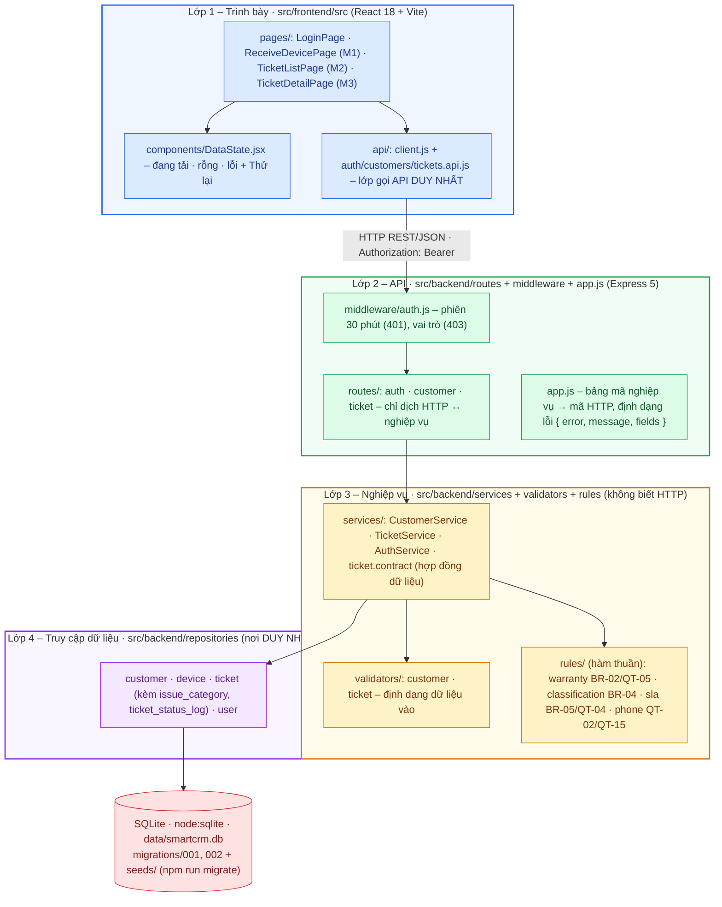

# Kiến trúc ĐÃ HIỆN THỰC – Bài tập 2 (luồng L2, track SE)

Sơ đồ dưới đây vẽ theo **mã nguồn thực tế** ở tag v0.2, không phải sơ đồ dự kiến của BT1
(`docs/architecture.drawio`). Các điểm khác BT1 ghi ở TD-04 và TD-09 trong `docs/thay-doi-thiet-ke.md`.
Ảnh tĩnh của sơ đồ: `docs/architecture-thuc-te.png`.

| Lớp | Thư mục | Kiểm chứng ranh giới |
|---|---|---|
| Trình bày | `src/frontend/src/pages`, `components`, `api` | Mọi lệnh `fetch` chỉ nằm trong `api/client.js` |
| API | `src/backend/routes`, `middleware`, `app.js` | Chỉ nơi này có `req`, `res`, mã HTTP |
| Nghiệp vụ | `src/backend/services`, `validators`, `rules` | Không có `req`, `res`, `status(`, `SELECT` (S2) |
| Truy cập dữ liệu | `src/backend/repositories` | Không có quy tắc nghiệp vụ, mọi SQL tham số hoá |
| Lưu trữ | `migrations/`, `seeds/`, `src/backend/migrate.js` | Dựng từ CSDL trống, chạy lại không nhân đôi (S3, C5) |
| Kiểm thử | `tests/` (`npm test`) | CSDL trong bộ nhớ hoặc repository giả, không phụ thuộc máy |

Chiều gọi chỉ đi xuống: trình bày → API → nghiệp vụ → truy cập dữ liệu → CSDL.
